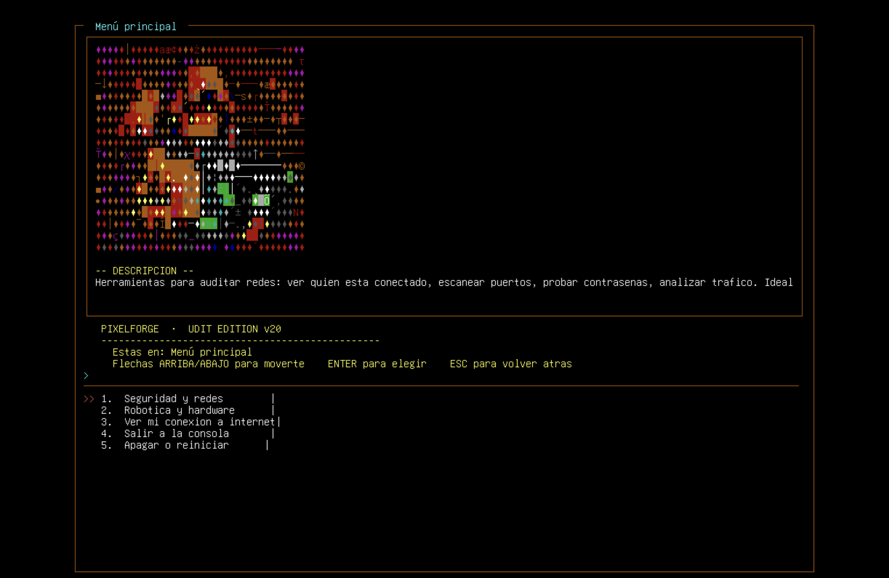

# UDIT PixelForge — a custom Linux distribution

**English** · [Español](README.es.md)

A live Linux distribution based on **Debian 13 (Trixie) for ARM64**. It boots straight into an XFCE
desktop with its own pixel-art theme, and it includes an interactive terminal menu (`robomenu`) with
tools for networking, security, diagnostics and hardware.

Final project for the **Advanced Operating Systems** course at UDIT (Madrid), 2025–2026.
**Authors:** Andrea Ávila Romero · Iván Herrera González



---

## What it is

- A bootable live ISO (1.2 GB) built by hand from a Debian 13 ARM64 base.
- XFCE 4.18 desktop with autologin, the Catppuccin Mocha Blue theme and custom pixel-art branding
  (wallpaper, login screen and Plymouth boot splash).
- `robomenu`: an interactive menu built with `fzf` and `chafa`. You can open it from any terminal.
- About 1,660 packages, grouped by category: network analysis, defensive and offensive security,
  system diagnostics, disk management, data recovery, Wi-Fi and robotics/hardware.

## How we built it

The ISO was built by hand, not with a GUI tool:
unpack the squashfs → install and configure packages in a `chroot` → repack the squashfs → build the
ISO with `xorriso`. The project went through 20 versions.

## The hardest problems

These three problems took most of the time. Each one needed us to understand a low-level detail.

1. **The ISO did not boot in Parallels on Apple Silicon.** Cubic creates a 32 MB `efi.img`. With that
   size, the `Ldsiz` field in the El-Torito boot catalog becomes `0`, and Parallels silently rejects
   the ISO. **Fix:** we changed the base image and built the ISO directly with `xorriso`, using the
   `-isohybrid-apm-hfsplus` option.
2. **Kernel panic at boot.** The squashfs was compressed with xz and the BCJ-arm filter. Tools in user
   space could extract it, but the squashfs driver in the arm64 kernel 6.12 could not.
   **Fix:** we rebuilt the squashfs with `zstd` (level 22, 1 MB blocks).
3. **Package installation stopped halfway.** `apt install` with a list of packages fails completely
   if one package does not exist (for example, `nikto` and `neofetch` are not in Debian 13).
   **Fix:** install the packages one by one in a loop and tolerate individual failures.

The full build log, every iteration and every fix are in the project manual:
[`MANUAL-PROYECTO.pdf`](MANUAL-PROYECTO.pdf) (in Spanish).

---

## Repository contents

| Path | Description |
|---|---|
| [`MANUAL-PROYECTO.pdf`](MANUAL-PROYECTO.pdf) | Technical manual: build process, log of all iterations (v8 → v20), problems and fixes. |
| `scripts/build_v20.sh` | Build script for v20 (starts from the v19 image). |
| `scripts/build_v20_resume.sh` | Variant that tolerates failures during the chroot install step. |
| `scripts/build_v20_robomenu_fix.sh` | Quick rebuild that only replaces the `robomenu` binary. |
| `scripts/run_qemu.sh` | Runs the ISO in QEMU (ARM64). |
| `scripts/v20-assets/robomenu` | The interactive menu (`fzf` + `chafa`). |
| `scripts/v20-assets/robosec-banner.sh` | Banner (`figlet` + `lolcat`) shown when a TTY opens. |
| `evidencias/screenshots/` | Screenshots of the running system. |
| `evidencias/branding/` | Theme assets: wallpapers, Plymouth theme, login screen. |
| `evidencias/iso-sha256-*.txt` | SHA-256 hashes of every delivered version. |

The `.iso` files are **not** in the repository because of their size (883 MB to 1.2 GB).

## Final version

| | |
|---|---|
| Version | v20 |
| Size | 1.2 GB |
| Base | Debian 13 Trixie ARM64 |
| Desktop | XFCE 4.18, Catppuccin Mocha Blue theme |
| Installed packages | 1,660 (dpkg) |
| SHA-256 | `3f8a04a8f1fe6ae5e9962cf555108c669fc7b95f2a28f1aaa97148ef384e612f` |

## Try it

**Parallels Desktop (Apple Silicon):** create a new VM from the ISO file, choose
*Other Linux (ARM64)*, give it 4 cores and 4 GB of RAM, and start it. It boots into XFCE with no
login. Open a terminal and run `robomenu`.

**QEMU:**

```bash
./scripts/run_qemu.sh debian-udit-pixelart-arm64-v20-final.iso 2048
```

**Check the ISO:**

```bash
echo "3f8a04a8f1fe6ae5e9962cf555108c669fc7b95f2a28f1aaa97148ef384e612f  debian-udit-pixelart-arm64-v20-final.iso" | sha256sum -c
```

### Default credentials

These are the default users of the live ISO. The ISO is a **lab environment for a university
course**; these are not credentials for any real system.

| User | Password | Groups |
|---|---|---|
| `danielsson` | `root` | sudo, wireshark, audio, video, netdev (autologin) |
| `user` | `live` | sudo, wireshark |
| `admin` | `admin` | sudo |
| `root` | `root` | — |

## Included tools

- **Network analysis:** nmap, masscan, wireshark, tshark, tcpdump, netcat, arp-scan
- **Defensive security:** lynis, fail2ban, ufw, chkrootkit, rkhunter, clamav, aide
- **Offensive security (for lab use):** hydra, john, hashcat, aircrack-ng, gobuster, whois
- **System diagnostics:** htop, btop, glances, lsof, iotop, strace, fastfetch
- **Disk management:** gparted, smartmontools, testdisk, ddrescue, cryptsetup
- **Recovery:** chntpw, photorec, safecopy
- **Wi-Fi:** iw, wavemon, wireless-tools, NetworkManager
- **Robotics / hardware:** avrdude, minicom, picocom, screen, esptool (pip)

The tool list follows the course assignment.

---

## License

Academic work. Free to use for educational purposes, with attribution.
